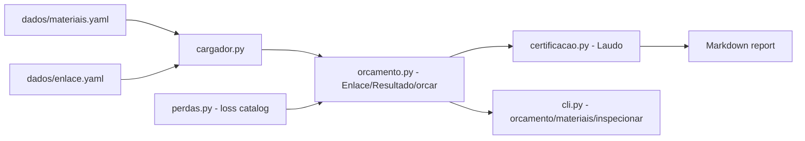

# calculadora-enlace-cobre

**English** · [Português (Brasil)](README.md)

[](#) [](#) [](#) [](LICENSE)

## What it is

**caboclink**: computes the loss budget of a copper link (Cat5e/Cat6/Cat6A) from a YAML file describing the channel — length, patch cords, connectors and patch panels — and prints a per-frequency verdict (`APROVADO` / caveat) with the margin in dB. It also writes a certification report in Markdown.

The calculation adds the cable's insertion loss to the components' loss and compares the total against the ISO/IEC 11801 channel limit (see `docs/tabela-de-perdas.md`).

## Status

Working and tested: **72 tests** passing (`pytest tests/`). A structured-cabling study project.

## Features

- **`orcamento`** (budget): reads the link YAML and prints FREQ / ORÇAMENTO / LIMITE / MARGEM / SITUAÇÃO plus a final verdict.
- **`materiais`**: lists cable categories and available components with their frequencies.
- **`inspecionar`**: prints the loss table used as reference.
- **Certification report** (`certificacao.py`): `--laudo path.md` writes the result as Markdown through the `Laudo` class.
- **Configurable margin**: `--margem` (default 1.5 dB) sets the minimum slack before a caveat.
- **Input data**: material catalog and sample links in `dados/*.yaml`.

## Architecture

A Python command-line tool with one module per responsibility; the YAML catalog feeds both the calculation and the report.



## Stack

- Python ≥ 3.10
- PyYAML ≥ 6.0 (only runtime dependency)
- pytest ≥ 7.4 (dev)
- GitHub Actions (`ci.yml`)

## Repository layout

```
calculadora-enlace-cobre/
├── pyproject.toml · requirements.txt · LICENSE
├── src/caboclink/
│   ├── cli.py            # orcamento/materiais/inspecionar subcommands
│   ├── cargador.py       # YAML loaders for materials and link
│   ├── orcamento.py      # Enlace, Resultado, orcar()
│   ├── perdas.py         # Material, CabosDisponiveis (loss table)
│   ├── certificacao.py   # Laudo / gerar_laudo()
│   └── __main__.py       # python -m caboclink
├── dados/                # materiais.yaml + sample links
├── docs/                 # how to read a datasheet, loss table
├── exemplos/             # sample report and outputs (pass/fail)
├── tests/                # 72 tests (cli, orcamento, perdas)
└── .github/workflows/ci.yml
```

## Prerequisites and installation

Python ≥ 3.10.

```bash
pip install -e .          # installs the `caboclink` CLI
pip install -e ".[dev]"   # optional: pytest
```

## How to run

```bash
caboclink orcamento dados/exemplo-enlace.yaml
#   FREQ  ORCAMENTO    LIMITE    MARGEM  SITUACAO
#    100      14.91     20.70      5.79  APROVADO
#    250      19.47     26.60      7.13  APROVADO
# VEREDITO: APROVADO

caboclink orcamento dados/enlace-longo-cat5e.yaml --margem 2.0 --laudo laudo.md
caboclink materiais
caboclink inspecionar

# or without installing
python -m caboclink orcamento dados/exemplo-enlace.yaml
```

## Tests and quality

Real command (verified by the agent):

```bash
python -m pytest tests/
# 72 passed
```

## Technical decisions and trade-offs

- **YAML as input**: links are described and versioned in the repository; in exchange, users must know the field names.
- **Channel limit (ISO/IEC 11801) against the total**: cable + connectors + patch panels instead of the cable alone; closer to the real channel.
- **Configurable margin, default 1.5 dB**: avoids approving a link sitting exactly on the limit.
- **Markdown report**: easy to attach to site documentation; in exchange, it is not a formatted certification PDF.

## Known limitations and roadmap

- Copper pairs only (no fiber, no NEXT/return-loss measurement).
- The material catalog is fictional, based on standard ranges — it does not replace each vendor's datasheet.
- No field measurement: it works from the values declared in the YAML.

## Development process

An individual project by Kelvin Oliveira, built with orchestrated AI agents and reviewed by the author. The loss model and the review are the author's.

## License and author

MIT — Copyright (c) 2026 Kelvin Rebelo de Oliveira.

**Author**: [Kelvin Oliveira](https://github.com/KelvinOliveiraCode) · [Portfolio](https://kelvinoliveiracode.github.io/portfolio/)
