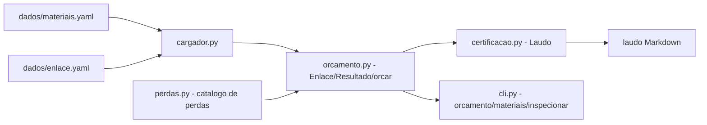

# calculadora-enlace-cobre

[English](README.en.md) · **Português (Brasil)**

[](#) [](#) [](#) [](LICENSE)

## O que é

**caboclink**: calcula o orçamento de perda de um enlace de cobre (Cat5e/Cat6/Cat6A) a partir de um arquivo YAML que descreve o canal — comprimento, patch cords, conectores e patch panels — e emite o veredito por frequência (`APROVADO` / ressalva) com a margem em dB. Também gera laudo de certificação em Markdown.

O cálculo soma a perda de inserção do cabo à dos componentes e compara com o limite do canal da ISO/IEC 11801 (ver `docs/tabela-de-perdas.md`).

## Status

Funcional e testado: **72 testes** passando (`pytest tests/`). Projeto de estudo de cabeamento estruturado.

## Funcionalidades

- **`orcamento`**: lê o YAML do enlace e imprime tabela de FREQ / ORÇAMENTO / LIMITE / MARGEM / SITUAÇÃO, com veredito final.
- **`materiais`**: lista as categorias de cabo e os componentes disponíveis (com as frequências de cada um).
- **`inspecionar`**: mostra a tabela de perdas usada como referência.
- **Laudo de certificação** (`certificacao.py`): `--laudo caminho.md` grava o resultado em Markdown, com a classe `Laudo`.
- **Margem configurável**: `--margem` (default 1.5 dB) define a folga mínima antes de marcar ressalva.
- **Dados de entrada**: catálogo de materiais e enlaces de exemplo em `dados/*.yaml`.

## Arquitetura

Ferramenta de linha de comando em Python com um módulo por responsabilidade; o catálogo YAML alimenta o cálculo e o laudo.



## Stack

- Python ≥ 3.10
- PyYAML ≥ 6.0 (única dependência de execução)
- pytest ≥ 7.4 (dev)
- GitHub Actions (`ci.yml`)

## Estrutura do repositório

```
calculadora-enlace-cobre/
├── pyproject.toml · requirements.txt · LICENSE
├── src/caboclink/
│   ├── cli.py            # subcomandos orcamento/materiais/inspecionar
│   ├── cargador.py       # leitura do YAML de materiais e de enlace
│   ├── orcamento.py      # Enlace, Resultado, orcar()
│   ├── perdas.py         # Material, CabosDisponiveis (tabela de perdas)
│   ├── certificacao.py   # Laudo / gerar_laudo()
│   └── __main__.py       # python -m caboclink
├── dados/                # materiais.yaml + enlaces de exemplo
├── docs/                 # como-ler-uma-ficha-tecnica.md, tabela-de-perdas.md
├── exemplos/             # laudo e saídas de exemplo (aprovada/reprovada)
├── tests/                # 72 testes (cli, orcamento, perdas)
└── .github/workflows/ci.yml
```

## Pré-requisitos e instalação

Python ≥ 3.10.

```bash
pip install -e .          # instala o CLI `caboclink`
pip install -e ".[dev]"   # opcional: pytest
```

## Como executar

```bash
caboclink orcamento dados/exemplo-enlace.yaml
#   FREQ  ORCAMENTO    LIMITE    MARGEM  SITUACAO
#    100      14.91     20.70      5.79  APROVADO
#    250      19.47     26.60      7.13  APROVADO
# VEREDITO: APROVADO

caboclink orcamento dados/enlace-longo-cat5e.yaml --margem 2.0 --laudo laudo.md
caboclink materiais
caboclink inspecionar

# ou sem instalar
python -m caboclink orcamento dados/exemplo-enlace.yaml
```

## Testes e qualidade

Comando real (verificado pelo agente):

```bash
python -m pytest tests/
# 72 passed
```

## Decisões técnicas e trade-offs

- **YAML como entrada**: enlaces descritos e versionáveis no próprio repositório; em troca, exige que quem usa saiba os nomes dos campos.
- **Limite do canal (ISO/IEC 11801) comparado ao total**: cabo + conectores + patch panels, em vez de tratar o cabo isolado; reflete o canal inteiro.
- **Margem configurável com default 1.5 dB**: evita aprovar enlace no limite exato.
- **Laudo em Markdown**: fácil de anexar em documentação de obra; em troca, não é um PDF com formato de certificado.

## Limitações conhecidas e roadmap

- Só pares de cobre (não cobre fibra óptica nem avaliação de NEXT/return loss por medição real).
- O catálogo de materiais é fictício, baseado em faixas de norma — não substitui a ficha técnica de cada fabricante.
- Sem medição de campo: trabalha com os dados declarados no YAML.

## Processo de desenvolvimento

Projeto individual de Kelvin Oliveira, construído com agentes de IA orquestrados e revisado pelo autor. O modelo de perda e a revisão são do autor.

## Licença e autor

MIT — Copyright (c) 2026 Kelvin Rebelo de Oliveira.

**Autor**: [Kelvin Oliveira](https://github.com/KelvinOliveiraCode) · [Portfólio](https://kelvinoliveiracode.github.io/portfolio/)
